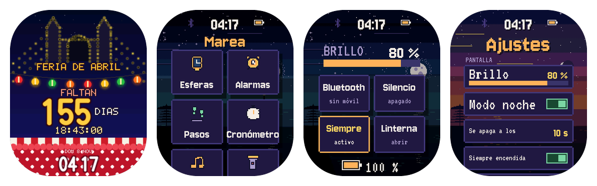

# Marea

Reloj de pulsera con **22 esferas a pantalla completa** y apps propias, para la **Waveshare ESP32-S3-Touch-AMOLED-2.06** (AMOLED 410×502 táctil, batería, reloj de hardware, acelerómetro, altavoz y microSD). Funciona a 30 fps, se queda conectado al móvil por Bluetooth mientras está cerca, se controla también desde el navegador por WiFi y se actualiza solo por internet.


- **Guía completa:** [wiki](https://github.com/CarlosNS/c6-fx-clock/wiki) (instalación, uso, app, esferas, solución de problemas, desarrollo)
- **Crea tu propia esfera:** [guía paso a paso](https://github.com/CarlosNS/c6-fx-clock/wiki/Crear-una-esfera)
- **Descargas** (firmware y app): [releases](https://github.com/CarlosNS/c6-fx-clock/releases)
- **Instalación por USB** desde el navegador: <https://carlosns.github.io/c6-fx-clock/flasher/>
- **Licencia:** software libre, [GPL-3.0-or-later](LICENSE): úsalo, modifícalo y compártelo; quien distribuya versiones debe publicar también su código ([más](#licencia))

El proyecto empezó como un reloj de sobremesa con un ESP32-C6 (de ahí el nombre del repositorio). Esa placa ya no se mantiene: su última versión es la 2.1.0.

## El reloj



El sistema sigue el estilo **Marea Solsticial**: pixel art nocturno junto al mar, paneles índigo, texto crema y el oro como acento. Cada esfera tiene su propio estilo.

| Gesto | En la esfera | En una app o un menú |
|---|---|---|
| Deslizar desde el borde de arriba | Ajustes rápidos: brillo, Bluetooth, silencio, siempre encendida, linterna y batería | |
| Deslizar desde el borde de abajo | Lanzador de apps | |
| Deslizar a izquierda o derecha | Esfera siguiente o anterior | |
| Mantener el dedo | Selector de esferas | |
| Deslizar desde el borde izquierdo | | Volver |
| **BOOT**, pulsación corta | Esfera siguiente | Volver |
| **BOOT**, pulsación larga | Cambio automático de esfera | |
| **BOOT** 10 s | Olvida los móviles emparejados | |

La pantalla se enciende con BOOT, con un toque o al levantar la muñeca, y se apaga sola (de 5 s a 10 min, o siempre encendida). Con ella apagada no se dibuja nada y el panel queda en reposo, pero el reloj sigue conectado al móvil y contando pasos.

**Manual:** [Manual del reloj](https://github.com/CarlosNS/c6-fx-clock/wiki/Manual-del-reloj) en la wiki.

**Apps:** Esferas, Alarmas (suenan por el altavoz y se posponen al agitar la muñeca), Pasos (podómetro con objetivo diario), Cronómetro, Música (lo que suena en el móvil, con sus controles), Linterna, Archivos (la microSD, con modo USB) y Ajustes. Llamadas: cuando el móvil suena, el reloj muestra quién llama y permite rechazarla o silenciarla. Textos en español o inglés.

## Esferas

Todas ocupan la pantalla entera, respetan sus esquinas redondeadas y van a 30 fps.

| # | Esfera | Cómo muestra la hora |
|---|--------|----------------------|
| 0 | Plasma | HH / MM enormes sobre plasma a resolución nativa |
| 1 | Cubo 3D | hora bajo el cubo; el cubo da una vuelta rápida en cada minuto |
| 2 | Túnel | 7 segmentos del color complementario, en el fondo oscuro del túnel |
| 3 | Lava | dígitos oscuros con borde luminoso entre las bolas de lava |
| 4 | Vida | horas encima de minutos, de células inmortales; al cambiar el minuto, los viejos se disuelven en la simulación |
| 5 | HUD | interfaz sci-fi: hora, temperatura del chip, señal WiFi, tiempo encendido y anillo de segundos; glitch cada minuto |
| 6 | Aventura | viaje en pixel art con parallax, lago con reflejos y luz según la hora real (amanecer, día, atardecer, noche con faroles y luciérnagas) |
| 7 | RPG | batalla 3D estilo JRPG: arena con círculo rúnico, cristal guardián y grupo; las barras de turno marcan los segundos y cada minuto se lanza un hechizo con la hora como daño |

**Basadas en obras famosas** (todas de dominio público; reinterpretaciones animadas, no copias):

| # | Esfera | Obra y animación |
|---|--------|------------------|
| 8 | Estrellada | *La noche estrellada* (Van Gogh, 1889): cielo de pinceladas en remolino, halos que laten, ciprés que se mece |
| 11 | Earthrise | Foto del Apolo 8 (NASA, 1968): Tierra 3D con continentes y nubes que giran saliendo sobre la Luna |

**Diseño libre:**

| # | Esfera | Descripción |
|---|--------|-------------|
| 9 | WiFi | la hora en grande sobre un espectro tenue de las redes WiFi de alrededor |
| 12 | Sakura | cerezo en flor junto a un estanque: pétalos que caen revoloteando y ondas donde tocan el agua |
| 13 | Synthwave | sol a franjas, rejilla de neón, palmeras, números cromados |
| 14 | Arena | reloj de arena con física de granos: se vacía exactamente en un minuto y gira |
| 15 | Engranajes | reloj mecánico de esqueleto: engranajes que engranan, volante oscilante, agujas con segundero |
| 17 | Lluvia | gotas-lente en el cristal sobre una ciudad desenfocada, hora en neón que parpadea |
| 18 | Agujero negro | disco de acreción con efecto Doppler, lente gravitatoria y anillo de fotones; las estrellas se curvan alrededor |
| 19 | Gol | jugada de fútbol en 16 bits: regate, salto sobre una entrada, gol por la escuadra, confeti y celebración; la hora en el marcador del estadio |
| 21 | Tiempo | esfera analógica con segundero de barrido; debajo, icono animado, temperatura, máx/mín y estado del cielo de la ciudad elegida |
| 22 | Clásico | reloj de vestir Art Déco: la pantalla es la caja, esfera sunburst con reflejos que se mueven (el color se elige en la app), índices y agujas dauphine doradas, fecha a las 3 y pequeño segundero a las 6 |
| 23 | Feria de Sevilla | cuenta atrás hasta el alumbrado de la Feria de Abril (la fecha se calcula sola cada año): portada de bombillas, farolillos, toldo y traje de lunares; durante la Feria, fuegos artificiales |
| 24 | Ónix | analógica minimalista para AMOLED: negro puro con los píxeles apagados, índices finos, agujas cálidas y una estela de luz como segundero; el color del acento se elige en la app y el dibujo se desplaza un poco cada minuto para cuidar la pantalla |

Los números 10, 16 y 20 están **retirados** (El grito, Acuario y Cuento) y no se vuelven a usar, para que ningún reloj cambie de esfera al actualizar.

**¿Quieres hacer la tuya?** `python tools/new_face.py burbujas "Burbujas"` crea una esfera a pantalla completa que ya funciona, lista para cambiarla. La guía está en la wiki: [Crear una esfera](https://github.com/CarlosNS/c6-fx-clock/wiki/Crear-una-esfera).

## El móvil

App Android **Marea** (Android 10 o superior), con la misma página de control que sirve el reloj:

- **Conexión permanente:** mientras el reloj está cerca, la app se queda conectada por Bluetooth (con un aviso fijo de Android, como cualquier app de reloj). Al conectar le pone la hora y el tiempo de su ciudad, y lo repite cada 30 minutos. Si el reloj se aleja o se apaga, la app vuelve a conectar sola cuando reaparece.
- **Música y llamadas:** con el permiso de leer notificaciones, el reloj muestra lo que suena en cualquier app de música (y la controla: reproducir, pausa, pistas y volumen) y avisa de las llamadas entrantes, que se pueden rechazar o silenciar desde la muñeca. No pide permisos de teléfono ni de contactos.
- **Con el estilo del reloj:** Inicio con los avisos y la esfera que se ve; Esferas con vista previa de cada una (y un ojo para sacarla del cambio automático); Alarmas que se crean, cambian y borran, con etiqueta, interruptor y animación; **órdenes de voz** (mantén BOOT y habla: el móvil lo entiende y el reloj pregunta antes de hacerlo); **buscar el reloj** (suena y parpadea, y la app dice lo cerca que está) y, desde el reloj, **buscar el móvil**; un tablón de **novedades**; Archivos para mirar la microSD; Ajustes con idioma (español o inglés, en el reloj y en la app) y **actualizaciones** del reloj y de la propia app por internet.
- Se empareja una vez, con la clave de 6 cifras que aparece en el reloj.

## Instalar y actualizar

- **Primera vez, por USB:** abre <https://carlosns.github.io/c6-fx-clock/flasher/> en Chrome o Edge y pulsa *Instalar el reloj*. Después, conecta el móvil a la red WiFi **Marea** (clave `mareamarea`) y abre `http://192.168.4.1` para darle tu WiFi, o empareja la app.
- **Por internet:** *Actualizaciones → Buscar actualización*, en la app o en la página. El reloj se reinicia en modo actualización, descarga la imagen comprobando proyecto, tamaño y SHA-256 y vuelve a su modo. Si algo falla, se queda con la versión que tenía.
- **Vuelta atrás automática:** una versión nueva tiene que funcionar 30 s para quedar confirmada; si se cuelga antes, el reloj vuelve solo a la anterior.

`python tools/build_webflasher.py` (tras `pio run`) genera `webflasher/marea.bin` (instalación completa) y `webflasher/marea-ota.bin` (solo el firmware). La flash de 32 MB tiene dos huecos de 7 MB para las actualizaciones y una partición de datos de 18 MB para más adelante.

## Hora, tiempo y microSD

- **Hora:** la ponen el móvil o internet (NTP), y la guarda el reloj de hardware de la placa, que sigue contando con el reloj apagado.
- **Tiempo:** [Open-Meteo](https://open-meteo.com), gratis y sin clave. Lo trae el móvil o el propio reloj por WiFi, cada 10 minutos; gana el dato más reciente. La ciudad se elige en *Esferas → Tiempo → Opciones* de la app o la página.
- **microSD:** la app Archivos muestra carpetas y archivos, borra y formatea. Su botón **USB** reinicia el reloj como disco USB para el ordenador; se vuelve al reloj con BOOT, expulsando el disco o desconectando el cable.

## Desarrollo

```bash
pio run -t upload                 # compilar y flashear (ESP-IDF 5.5 con PlatformIO, puerto COM7)
python tools/bootlog.py           # reinicia el reloj y muestra su arranque
cd tests && python -m pytest -m now --ignore=wifi   # tests unitarios
```

```
transportes   web.c (HTTP + WebSocket)     ble.c (GATT, NimBLE)     console.c (serie)
control       control.c (órdenes de texto y estado JSON)   settings.c (tabla de ajustes)
              ota.c / update.c (actualizaciones)   bootmode.c (normal / actualización / USB)
sistema       sys.c (vistas, lanzador, ajustes rápidos)   input.c (gestos)   ui.c (estilo Marea Solsticial)
              app_*.c (apps)   alarm.c   steps.c   audio.c (ES8311)   phone.c (música y llamadas)
servicios     net.c (WiFi)   clock.c (hora)   weather.c (tiempo)   usbdisk.c (modo USB)
pantalla      main.c (bucle a 30 fps, reposo, botón)   fx_*.c (esferas)   gfx.c   lcd_co5300.c
placa         board.c   pmu_axp2101.c   rtc_pcf85063.c   touch_ft3168.c   imu_qmi8658.c
```

- **Órdenes:** todo se controla con mensajes de texto (`bri 80`, `fx 3`, `loc 37.38 -5.98 Sevilla`, `ui launcher`…), iguales por WiFi, Bluetooth y consola serie. La lista está en `src/control.h`.
- **Pantalla:** el sistema y Plasma dibujan a 410×502; las demás esferas, en un lienzo de 274×336 que se amplía ×1,5 al enviar, porque escribir la PSRAM es lo que más cuesta. Detalles en la wiki, página *Arquitectura*.
- **App:** `cd android && gradlew assembleRelease` (JDK 21 y el SDK de Android; la firma necesita `android/keystore.properties`, que no está en git).

Más en [CLAUDE.md](CLAUDE.md), la wiki *Compilar y contribuir* y [CONTRIBUTING.md](CONTRIBUTING.md).

## Licencia

Copyright 2026 CarlosNS. Es **software libre y open source**: puedes redistribuirlo y modificarlo según los términos de la Licencia Pública General de GNU, versión 3 o posterior ([GPL-3.0-or-later](LICENSE)).

- **Puedes**, sin pedir permiso y para cualquier fin (también comercial): usarlo, estudiarlo, modificarlo, compartirlo y venderlo.
- **A cambio**, quien distribuya el firmware o la app, originales o modificados (también instalados en un reloj que venda), debe hacerlo con la misma licencia, dar el código fuente completo de su versión y mantener el aviso de copyright. Nadie puede cerrar el código ni quedarse las mejoras para sí.
- **Otra licencia:** si quieres incluir el proyecto en un producto sin publicar tu código, abre una [issue](https://github.com/CarlosNS/c6-fx-clock/issues/new?title=Licencia%20comercial) con el título *Licencia comercial* y acordamos las condiciones.

Se ofrece sin ninguna garantía. Los componentes de terceros conservan sus licencias: [THIRD-PARTY-NOTICES.md](THIRD-PARTY-NOTICES.md). Para contribuir: [CONTRIBUTING.md](CONTRIBUTING.md).
