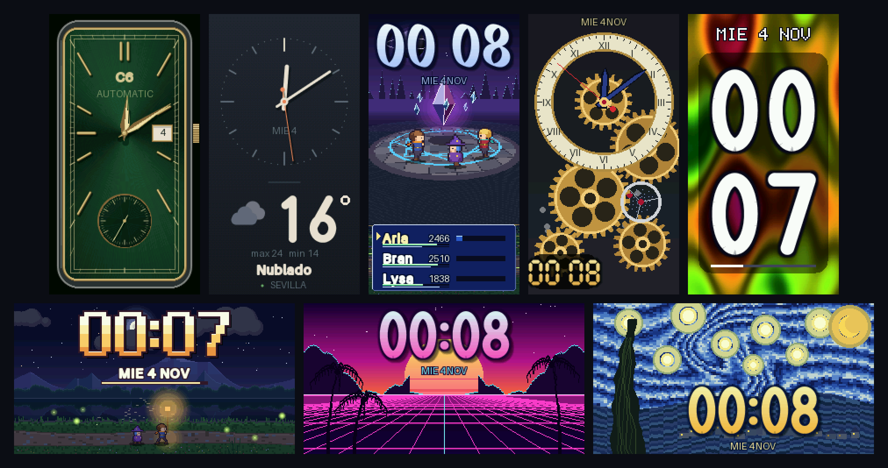

# ESP32-C6 FX Clock

Reloj con **21 esferas animadas** para la **Waveshare ESP32-C6-LCD-1.47** (ST7789, 172×320), a 30 fps. Se controla desde el móvil con la app Android por Bluetooth, o desde el navegador por WiFi, y se actualiza solo por internet.



- **Guía completa:** [wiki](https://github.com/CarlosNS/c6-fx-clock/wiki) (instalación, uso, app, esferas, solución de problemas, desarrollo)
- **Crea tu propia esfera:** [guía paso a paso](https://github.com/CarlosNS/c6-fx-clock/wiki/Crear-una-esfera)
- **Descargas** (firmware y app): [releases](https://github.com/CarlosNS/c6-fx-clock/releases)
- **Instalación por USB** desde el navegador: <https://carlosns.github.io/c6-fx-clock/flasher/>
- **Licencia:** software libre, [GPL-3.0-or-later](LICENSE): úsalo, modifícalo y compártelo; quien distribuya versiones debe publicar también su código ([más](#licencia))

## Esferas

| # | Esfera | Orientación | Cómo muestra la hora |
|---|--------|-------------|----------------------|
| 0 | Plasma | vertical | HH / MM grandes sobre panel oscuro translúcido |
| 1 | Cubo 3D | vertical | hora bajo el cubo; el cubo da una vuelta rápida en cada minuto |
| 2 | Túnel | vertical | 7 segmentos del color complementario al túnel |
| 3 | Lava | vertical | dígitos oscuros con borde luminoso |
| 4 | Vida | horizontal | dígitos de células inmortales; al cambiar el minuto, los viejos se disuelven en la simulación |
| 5 | HUD | horizontal | interfaz sci-fi: anillo de segundos, temperatura del chip, señal WiFi, glitch cada minuto |
| 6 | Aventura | horizontal | viaje en pixel art a resolución nativa: parallax con bruma atmosférica, lago con reflejos, luz según la hora real (amanecer, día, atardecer, noche con faroles y luciérnagas) |
| 7 | RPG | vertical | batalla 3D estilo FF VIII–X: cámara cinemática, arena con círculo rúnico, cristal guardián, grupo en HD-2D; las barras ATB marcan los segundos y cada minuto se lanza un hechizo con la hora como daño |

**Basadas en obras famosas** (todas de dominio público; reinterpretaciones animadas, no copias):

| # | Esfera | Orientación | Obra y animación |
|---|--------|-------------|------------------|
| 8 | Estrellada | horizontal | *La noche estrellada* (Van Gogh, 1889): cielo de pinceladas en remolino, halos que laten, ciprés que se mece |
| 11 | Earthrise | horizontal | Foto del Apolo 8 (NASA, 1968): Tierra 3D con continentes y nubes que giran saliendo sobre la Luna |

**Diseño libre:**

| # | Esfera | Orientación | Descripción |
|---|--------|-------------|-------------|
| 9 | WiFi | horizontal | la hora en grande sobre un espectro tenue de las redes WiFi de alrededor (escaneo en segundo plano) |
| 12 | Sakura | horizontal | cerezo en flor junto a un estanque: pétalos que caen revoloteando y ondas donde tocan el agua |
| 13 | Synthwave | horizontal | sol a franjas, rejilla de neón, palmeras, números cromados |
| 14 | Arena | vertical | reloj de arena con física de granos: se vacía exactamente en un minuto y gira |
| 15 | Engranajes | vertical | reloj analógico mecánico: engranajes que engranan, volante oscilante, agujas con segundero |
| 17 | Lluvia | vertical | gotas-lente en el cristal sobre una ciudad desenfocada, hora en neón que parpadea |
| 18 | Agujero negro | horizontal | disco de acreción con efecto Doppler, lente gravitatoria del disco trasero y anillo de fotones; las estrellas se curvan alrededor (ecuación de lente puntual) |
| 19 | Gol | horizontal | jugada de fútbol en 16 bits con un delantero inspirado en Mbappé: regate, salto sobre una entrada, gol por la escuadra con el portero vencido, confeti y celebración con los brazos cruzados; la hora en el marcador del estadio. Los jugadores son esqueletos 2D rasterizados a media resolución con sombreado y contorno, así cada pose se interpola suave |
| 21 | Tiempo | vertical | minimalista: esfera analógica con agujas suavizadas y segundero de barrido; debajo, icono animado, temperatura, máx/mín y estado del cielo de la ciudad configurada. El fondo cambia con el tiempo (sol, gris, lluvia, noche) |
| 22 | Clásico | vertical | reloj de vestir rectangular Art Déco: caja de metal pulido con corona, esfera sunburst cuyos reflejos se mueven (verde por defecto; el color se elige con un slider en la web), minutería de raíles, índices y agujas dauphine doradas, fecha a las 3 y pequeño segundero a las 6 con 8 pulsos por segundo |
| 23 | Feria de Sevilla | vertical | cuenta atrás hasta el alumbrado de la Feria de Abril (la fecha se calcula sola cada año a partir de la Semana Santa): portada de bombillas que parpadean, farolillos que se mecen, toldo de caseta y traje de lunares con la hora; durante la Feria, fuegos artificiales y el día en que va, y después la cuenta atrás hacia la del año siguiente |

Los números 10, 16 y 20 están **retirados**: eran esferas eliminadas (El grito, Acuario y Cuento) y no se vuelven a usar, para que ningún reloj cambie de esfera al actualizar. Si un reloj tenía elegida una de ellas, muestra la siguiente.

Todas van limitadas a **30 fps**.

**¿Quieres hacer la tuya?** `python tools/new_face.py burbujas "Burbujas"` crea una esfera que ya funciona, lista para cambiarla. La guía completa (pantalla, hora, herramientas de dibujo, rendimiento, ajustes propios y cómo enviarla) está en la wiki: [Crear una esfera](https://github.com/CarlosNS/c6-fx-clock/wiki/Crear-una-esfera).

## Instalar y actualizar

`python tools/build_webflasher.py` (tras `pio run`) genera en `webflasher/` dos archivos:

| Archivo | Para qué |
|---|---|
| `c6-fx-clock.bin` | Instalación completa por USB (bootloader + tabla de particiones + firmware). Primera instalación o recuperación. |
| `c6-fx-clock-ota.bin` | Solo el firmware, para actualizar **por WiFi** subiendo el archivo desde la web del reloj. Normalmente no hace falta: el reloj se actualiza solo por internet (abajo). |

### Por USB (webflasher)

1. Doble clic en **`webflasher/Abrir flasher.bat`** (necesita Python; abre `http://localhost:8765`).
2. En Chrome o Edge, pulsa **Instalar el reloj** y elige el puerto de la placa.
3. Si eliges borrar el dispositivo, luego conecta el móvil a `C6-FX-Demo` y configura tu WiFi en la sección **Conexión** de `http://192.168.4.1`.

La misma página está publicada en <https://carlosns.github.io/c6-fx-clock/flasher/> (siempre con la última versión): basta con abrirla en Chrome o Edge.

### Por WiFi (OTA)

En la web del reloj: **Avanzado → Actualizar por WiFi**, elige `c6-fx-clock-ota.bin` y pulsa *Actualizar firmware* (unos 7 s). La pantalla muestra el progreso y el reloj se reinicia solo con la versión nueva.

- La flash tiene dos huecos de 3,5 MB (`ota_0` / `ota_1`): la actualización se escribe en el que no está en uso, así que un corte a medias no estropea nada.
- Solo acepta firmware de este proyecto: otro archivo se rechaza antes de escribir nada.
- **Vuelta atrás automática:** una versión nueva debe funcionar 30 s para quedar confirmada; si se cuelga antes, el reloj vuelve solo a la anterior en el siguiente arranque.
- Cambiar la tabla de particiones (como el paso a 2.0.0) exige una instalación por USB; OTA solo sustituye el firmware.

### Por internet (desde 2.1.0)

En la página de control (también en la app y en modo Bluetooth): **Actualizaciones → Buscar actualización**. El móvil o el navegador lee `https://carlosns.github.io/c6-fx-clock/manifest.json` y, si hay versión nueva, *Actualizar* envía `update apply <manifiesto>`. El reloj se reinicia en modo UPDATE, se conecta a su red WiFi guardada, descarga la imagen comprobando proyecto, tamaño y SHA-256 (máximo 5 min) y vuelve al modo en que estaba. El resultado (`updated`, `up_to_date`, `no_wifi`, `bad_image`, `timeout`, `interrupted`…) aparece en la página. Si algo falla, se queda la versión actual; un corte de corriente a mitad tampoco la estropea.

La red WiFi se puede guardar también en modo Bluetooth (*Conexión*): el reloj solo la usa para actualizarse. Publicar una versión (sube el número en `CMakeLists.txt` antes):

```
python tools/release.py --notes "Qué cambia"    # compila, GitHub Pages + release con la app
```

## Uso

El reloj tiene dos modos (en el C6 el WiFi y el Bluetooth no caben a la vez en la RAM). Para cambiar de uno a otro: botón en la página de control (*Avanzado → Modo de conexión*) o mantener **BOOT 2 s** en la pantalla de bienvenida.

- **Bluetooth:** se controla con la app Android (abajo). La primera vez se empareja con la clave de 6 cifras que aparece en el reloj. La app le pone la hora y el tiempo cada 30 min aunque esté cerrada.
- **WiFi:** se controla desde el navegador, como hasta la 2.0:

1. Compila y flashea: `pio run -t upload` (puerto COM5).
2. Abre el panel web:
   - en tu WiFi: la IP aparece en la pantalla al arrancar;
   - o conecta el móvil a **C6-FX-Demo** (clave `esp32c6fx`) y abre **http://192.168.4.1**.
3. **Pantalla**: apagada por defecto (no se renderiza nada). El **botón BOOT** la enciende el tiempo elegido en la web (*Apagar la pantalla tras*: de 5 s a 10 min; 10 s por defecto); con ella encendida, pulsación corta = siguiente esfera, larga = cambio automático. Usar la web también la mantiene encendida. Opción *Pantalla siempre encendida* en la web.

### Hora

- En modo Bluetooth la pone la app del móvil (al abrirla y cada 30 min).
- En modo WiFi se sincroniza por **NTP** si la red tiene salida a internet (zona horaria Europe/Madrid con horario de verano).
- Si no, la **web la envía sola** al abrirla (o con el botón *Sincronizar hora*).
- La placa no tiene batería de reloj: tras quitar la corriente hay que volver a sincronizar.

### Tiempo

- Fuente: [Open-Meteo](https://open-meteo.com) (gratis, sin clave). En modo WiFi la placa lo consulta sola cada 10 min; en modo Bluetooth se lo manda la app.
- Si la red no tiene salida a internet, la web lo consulta desde el móvil al abrirla y se lo pasa a la placa.
- Ciudad: tarjeta **Tiempo** de la web (busca por nombre y elige el resultado). Por defecto, Sevilla.

### Ajustes (se guardan en flash)

Esfera, brillo, velocidad, 24/12 h, segundos, cambio automático (con las esferas que elijas) y **modo noche** (por defecto 23:00–07:00 al 10 % de brillo, con el LED apagado).

### Depuración

- `GET /screenshot` devuelve la pantalla como BMP. Parámetros opcionales: `fx` (esfera), `h` y `m` (simular una hora), `wait` (ms antes de capturar).
- `GET /status` incluye `rus` / `rmax`: tiempo medio y máximo de render por fotograma (µs). El presupuesto a 30 fps es 33 ms.
- `GET /faces` devuelve el catálogo de esferas (nombre, grupo, descripción, si es interactiva, ajustes propios).

## Detalles técnicos

- Cifras temáticas: Aventura usa dígitos pixel art 7×10 (degradado crema-dorado, bisel, contorno y sombra, como los HUD de RPG de 16 bits); RPG usa numerales caligráficos de pluma ancha con serifas y degradado (`font_nib_*`), en la línea de los menús de los JRPG de PS1/PS2. Todo diseño propio.
- Texto de interfaz suavizado generado por `tools/gen_uifont.py` con Aileron (dominio público, incluida en Pillow).
- Mezcla de color RGB565 con una sola multiplicación (canales empaquetados en 32 bits); el C6 no tiene FPU y divide lento.
- Fuentes grandes generadas por `tools/gen_fonts.py` (dígitos de diseño propio, sin fuentes externas): cobertura + contorno en 4 bits por píxel para que se lean sobre cualquier fondo.
- Rotación por hardware (MADCTL) según la esfera; mismo framebuffer en ambas orientaciones.
- Doble framebuffer (2 × 110 KB) con DMA; el código de WiFi/lwIP/FreeRTOS va en flash para dejar heap a la red (~33 KB libres en marcha).
- Flash de 8 MB: `nvs` (ajustes y WiFi), `otadata`, dos huecos de app de 3,5 MB para OTA y 896 KB libres (`storage`) para el futuro.
- DNS públicos (1.1.1.1 / 8.8.8.8): algunos routers rechazan las consultas DNS de la LAN.
- WiFi en redes malladas: busca en todos los canales y se une al nodo con mejor señal; si un nodo acepta la conexión pero no da IP en 20 s, se pasa al siguiente nodo más fuerte de la misma red.

## Arquitectura

```
transportes        web.c (HTTP + WebSocket)        ble.c (GATT, NimBLE)        console.c (serie)
                            |                             |
control            control.c  -- comandos de texto y JSON de estado --
                   settings.c -- tabla única de ajustes (NVS, comando y JSON con la misma clave)
                   ota.c      -- actualización por trozos, sin depender del transporte
                   update.c   -- modo UPDATE: manifiesto, descarga HTTPS, SHA-256, resultado
                   bootmode.c -- modos BLE / WIFI / UPDATE (NVS)
servicios          net.c (WiFi)   clock.c (hora)   weather.c (tiempo)
pantalla           main.c (bucle a 30 fps, reposo, botón)   fx_*.c (esferas)   gfx.c / lcd.c
```

- **Comandos:** todo se controla con mensajes de texto (`bri 80`, `fx 3`, `loc 37.38 -5.98 Sevilla`, `wifi`...). La lista completa está en `control.h`. Cualquier transporte solo tiene que pasar esos textos a `app_command()` y leer `app_status_json()`.
- **Ajustes:** añadir uno es una línea en `settings.c`; se guarda, se controla por comando y aparece en el estado sin tocar nada más.
- **Esferas:** cada una se describe una sola vez en `fx_list` (`fx_common.c`): nombre, grupo, descripción, si es interactiva y sus ajustes propios. La web construye su menú a partir de `/faces`.

### Bluetooth

Hecho según `docs/PLAN-bluetooth.md`. Para controlarlo hay que emparejar con la clave de 6 dígitos que muestra el reloj (hasta 3 móviles; BOOT 10 s los olvida). El reloj se anuncia como `C6 Clock XXXX` y acepta los mismos comandos que la web; desde el PC:

```
python tools/ble_console.py          # comandos a mano
python tools/fake_phone.py           # una sincronización como la hará la app
python tools/ble_shot.py --fx 22     # captura de pantalla por Bluetooth (PNG)
```

La misma página de control funciona por los tres caminos: servida por el reloj en modo WiFi, desde Chrome/Edge por Web Bluetooth (abre `src/index.html` en `http://localhost`) y dentro de la app. Lo único que cambia es el enlace, en `src/transport.js`.

### App Android (`android/`)

App en Kotlin con la página de control en un WebView. El emparejamiento lo hace el sistema (Companion Device Manager) con la clave de la pantalla del reloj. Cada 30 min, aunque la app esté cerrada, sincroniza la hora y el tiempo de la ciudad del reloj; al encender el reloj o volver a estar cerca le pone la hora en segundos (Android 12+). Avisa de firmware y de app nuevos, y la app se actualiza sola. Requiere Android 10 o superior.

```
cd android
gradlew assembleDebug        # app/build/outputs/apk/debug/app-debug.apk
gradlew test                 # tests unitarios (troceado, sincronización)
gradlew assembleRelease      # firmada; necesita android/keystore.properties (no está en git)
```

Necesita JDK 21 (`JAVA_HOME`) y el SDK de Android (`android/local.properties` con `sdk.dir=...`).

## Licencia

Copyright 2026 CarlosNS. Es **software libre y open source**: puedes redistribuirlo y modificarlo según los términos de la Licencia Pública General de GNU, versión 3 o posterior ([GPL-3.0-or-later](LICENSE)).

- **Puedes**, sin pedir permiso y para cualquier fin (también comercial): usarlo, estudiarlo, modificarlo, compartirlo y venderlo.
- **A cambio**, quien distribuya el firmware o la app, originales o modificados (también instalados en un reloj que venda), debe hacerlo con la misma licencia, dar el código fuente completo de su versión y mantener el aviso de copyright. Nadie puede cerrar el código ni quedarse las mejoras para sí.
- **Otra licencia:** si quieres incluir el proyecto en un producto sin publicar tu código, abre una [issue](https://github.com/CarlosNS/c6-fx-clock/issues/new?title=Licencia%20comercial) con el título *Licencia comercial* y acordamos las condiciones.

Se ofrece sin ninguna garantía. Los componentes de terceros conservan sus licencias: [THIRD-PARTY-NOTICES.md](THIRD-PARTY-NOTICES.md). Para contribuir: [CONTRIBUTING.md](CONTRIBUTING.md).
